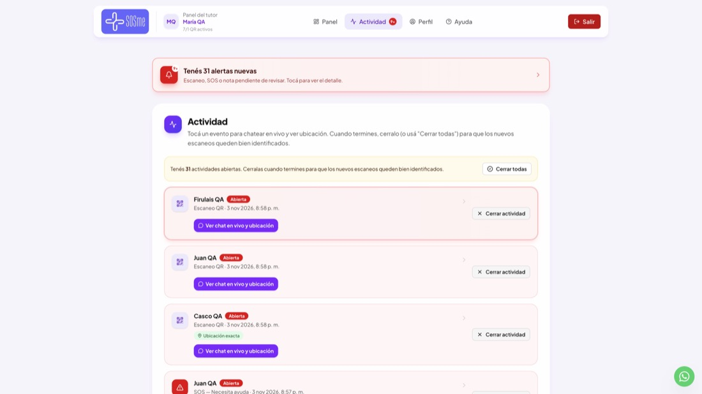
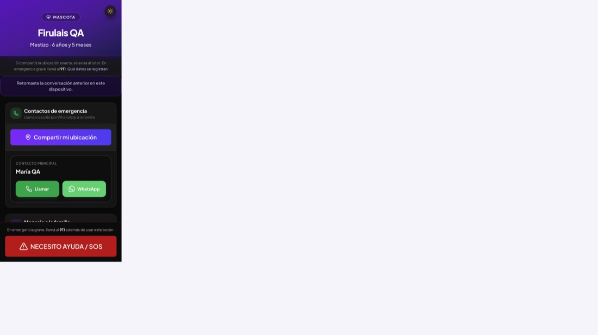
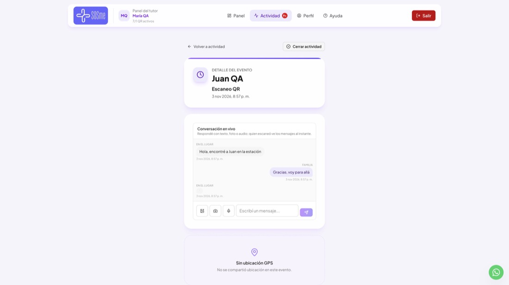
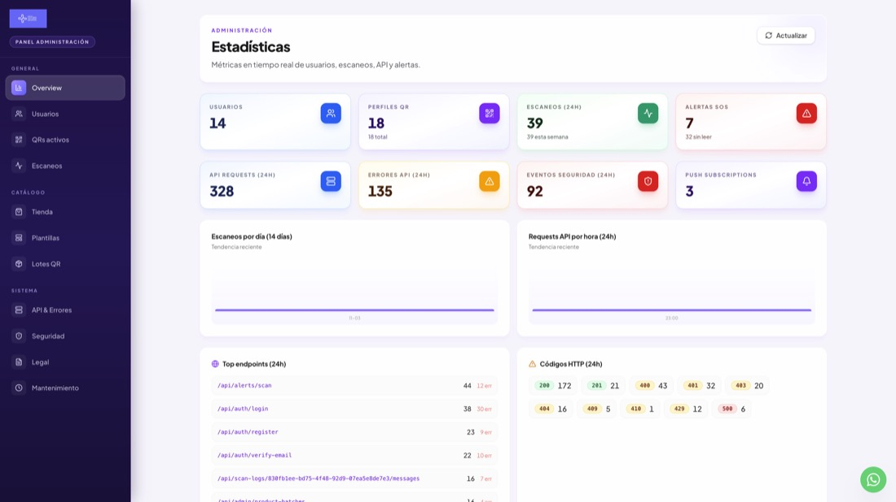

# Reporte de QA — SOSme — 3 de noviembre de 2026

## Resumen

Se corrieron **207 casos** de punta a punta sobre la app compilada en modo producción (`next build` + `next start`), con base de datos, mails y notificaciones push reales pero locales y descartables.

| Resultado | Casos |
|---|---|
| OK | 187 |
| Fallas | 3 |
| Avisos | 17 |

**Veredicto:** los flujos centrales funcionan. Escanear un QR, avisar al tutor, compartir ubicación, el SOS, el chat en los dos sentidos, los co-tutores, la libreta sanitaria con el link de veterinario, la tienda, el panel de admin y los cron dan los resultados esperados. Los textos de cada push se verificaron descifrando la notificación real. Las 3 fallas son de severidad media o baja y ninguna rompe la emergencia. Lo más importante para corregir:

1. **Endpoint interno sin autenticación** (`/api/internal/scan-logs/:id/read-status`): la validación de la clave quedó comentada “para debug”.
2. **Borrar un perfil deja el producto físico inutilizable**: el código queda activado sin perfil y no se puede volver a usar.
3. **Las APIs no exigen email verificado**: una cuenta sin confirmar puede activar productos y operar llamando a la API directo.
4. **“7/1 QR activos”** en el encabezado del panel: el plan Inicial dice 1 perfil, pero la activación por producto no tiene tope.

## Cómo se probó

- App: build de producción de `main` (commit `ac55548` más este cambio), servida en `localhost:3100`.
- Base: Postgres en memoria (PGlite) con las 43 migraciones de `db/migrations`, expuesta con el mismo protocolo HTTP que Neon. Producción no se tocó.
- Mails: receptor SMTP local. Se leyeron los mails reales que manda la app (verificación, recuperación, co-tutor).
- Push: VAPID de prueba y suscripciones con claves reales. Cada push que manda el servidor se capturó y se **descifró** (RFC 8291) para verificar título, texto y enlace.
- Recorrido visual en el navegador: la página de escaneo en un celular, la actividad y el chat del tutor, y el panel de admin.
- Para repetirlo: `npm run qa` (ver [`README.md`](README.md)).

## Hallazgos

### Severidad media

**1. Endpoint interno sin autenticación** (falla)
`src/app/api/internal/scan-logs/[id]/read-status/route.ts` tiene comentada la validación de `x-n8n-api-key` (“TEMPORAL: auth deshabilitada para debug”). Cualquiera con un id de escaneo sabe si el tutor lo leyó y cuándo. El riesgo es bajo porque el id es un UUID, pero es una puerta abierta en producción. **Arreglo:** descomentar el chequeo y configurar `INTERNAL_N8N_KEY` en Vercel y en n8n.

**2. Borrar un perfil deja el producto físico inutilizable**
Al borrar el perfil, `qr_activations` queda `claimed` con `profile_id` en null. Reactivar el código da 409 (“Este código ya fue activado”), y `/activar/:code` redirige a `/p/:slug`, que da 404. Quien compró una chapita y borra el perfil, o pide la baja de la cuenta, pierde el producto. La ayuda dice “borra el perfil y su QR (acción irreversible)”, pero no aclara que la chapita queda muerta. **Arreglo sugerido:** al borrar, volver la activación a `unclaimed` y conservar `public_slug`. Si no, avisarlo claramente en la confirmación.

**3. Las APIs no exigen email verificado**
Solo el middleware de páginas manda a `/verificar`. Una cuenta recién registrada, sin confirmar el mail, activó un producto por `POST /api/activar/:code` (200). Lo mismo vale para editar, compartir y suscribir push. **Arreglo:** chequear `isSessionVerified` en `withApi` para las rutas autenticadas, salvo `verify-email`, `resend-code`, `logout` y `me`.

**4. Plan Inicial: el panel muestra “7/1 QR activos”**

`PLANS.free.maxProfiles = 1`, pero activar productos no tiene tope. La tutora de QA quedó con 7 perfiles y `canCreateMore: false`. Es coherente con “cada producto trae su QR”, pero el contador confunde. **Arreglo:** que el tope no cuente los perfiles de productos, o dejar de mostrar `x/1`.

**5. La ayuda describe un “Plan Pro” que no existe en el código**
La ayuda (`src/lib/help/content.ts`), la tienda (`pro-promo.ts`, “1 año Pro”) y las páginas de servicios dicen que co-tutores y libreta sanitaria son Pro, que vienen por un plazo con el producto y que después se cortan si no se renueva. En el código, “Pro” existe solo en esos textos: los planes son `free`, `extended` y `partner`, no se guarda ningún vencimiento y ninguna ruta chequea el plan para co-tutores ni libreta. Una cuenta Inicial usó las dos cosas sin restricción. **Arreglo:** decidir si es intencional (gratis por ahora) y ajustar la ayuda, o implementar el corte.

### Severidad baja

| # | Hallazgo | Dónde | Sugerencia |
|---|---|---|---|
| 6 | Ubicación del escaneador sin validar (falla). `longitude: "abc"` da 500. `latitude: 999` se guarda y **le manda al tutor el push “ubicación exacta”** con una coordenada imposible. | `PATCH /api/alerts/location`, también `POST /api/alerts/sos` | Validar números finitos en -90..90 / -180..180, como `saved-locations`. |
| 7 | IDs mal formados devuelven 500 (falla). | `/api/qr-profiles/:id`, `/api/scan-logs/:id`, `/api/qr-profiles/:id/shares` | `isUuid` antes de consultar, como ya hacen `medical-records` y `vet-view`. |
| 8 | JSON mal formado devuelve 500. | login, register, `alerts/scan` | Responder 400 “JSON inválido”. |
| 9 | Dos cuentas activando el mismo código a la vez: una gana y la otra recibe 500 en vez de 409. | `claimActivationForUser` crea el perfil antes del `UPDATE … WHERE status='unclaimed'` | Capturar la violación de slug único y devolver el error `RACE`. |
| 10 | Activar productos usa el límite del login (10 cada 15 min por IP). La activación 10 de 12 seguidas dio 429. | `POST /api/activar/:code` (preset `auth`) | Preset propio, por usuario. |
| 11 | El push de prueba dice “Vas a recibir avisos cuando escaneen tu QR”, pero desde el último cambio un escaneo solo no avisa. | `src/app/api/push/subscribe/route.ts` | Alinear el texto con la ayuda: ubicación exacta, SOS, mensaje o visita. |
| 12 | El endpoint push acepta cualquier URL https y el servidor le hace POST (SSRF acotado). | `POST /api/push/subscribe` | Lista de hosts de servicios push conocidos. |
| 13 | El chat acepta slug + id de escaneo sin token (camino legado). | `resolveAccess` en `scan-logs/[id]/messages` | Quitar el fallback; el token ya cubre el caso. |
| 14 | La vista previa pública de una invitación muestra el email del dueño. | `GET /api/profile-share-invites/:token` | Mostrar solo el nombre. |
| 15 | La home muestra solo 2 collares fijos; 6 productos activos (Chapita QR, Sticker, Imán…) no aparecen, y uno nuevo del admin tampoco aparecería. | `withStoreCatalogFallback` (slugs fijos) | Confirmar si es intencional. |
| 16 | Pedidos de la tienda: no llega ningún mail (ni al equipo ni al cliente). Se aceptan 10 000 unidades, y una cantidad 0 o negativa se corrige a 1 en silencio. | `POST /api/store/orders` | Aviso al equipo y tope de cantidad. |
| 17 | El registro espera el envío del mail. Si el SMTP se cuelga, nodemailer espera 2 minutos (pasó durante el armado del QA), más que el límite de una función en Vercel. | `issueVerificationCode` / `send-email.ts` | `connectionTimeout`/`greetingTimeout` cortos (~10 s). |
| 18 | “Errores API (24h)” del admin cuenta todos los 4xx (logins fallidos, 401 esperables): en esta corrida, 135 de 328. | `/api/admin/stats` | Separar 5xx de 4xx. |
| 19 | `scripts/migrate-all.mjs` aplica solo hasta la 035; faltan de la 036 a la 043. Las 036/037 se aplican en caliente (`ensure-schema.ts`), pero las de productos (038–043) no. | `scripts/migrate-all.mjs` | Leer la carpeta en orden en vez de una lista fija. |
| 20 | El rate limit confía en `X-Forwarded-For`. En Vercel no se puede falsear, detrás de otro proxy sí. | `getClientIp` | Preferir `x-vercel-forwarded-for`. |

Informativos, sin acción necesaria: compartir con un email sin cuenta responde “No hay una cuenta SOSme con ese email”, y durante los 30 días de gracia de una baja el QR sigue respondiendo.

## Qué funciona bien

- **Escaneo:** registra el evento y el escaneador recibe un token de sesión. Un escaneo sin ubicación exacta **no** avisa, como dice el producto. La ubicación por IP queda marcada como aproximada, y al recargar se retoma la conversación.
- **Push al tutor** (verificado descifrando cada notificación):
  - Ubicación exacta: “📍 Ubicación — Juan QA”, con enlace a `/dashboard/logs/:id`.
  - SOS: “🆘 SOS — Juan QA”.
  - Mensaje del chat: “💬 Mensaje”, con el texto, o “Envió una foto”.
  - Visita del veterinario: “🐾 Visita veterinaria — Firulais QA”.
  - Recordatorio de vacuna: “💉 Próxima vacuna — … vence mañana”, sin repetirse en la misma ventana.
  - Llega a todos los dispositivos del tutor y a los co-tutores con permiso. Las suscripciones vencidas (410) se borran solas.
- **Chat:** funciona en los dos sentidos. El escaneador recibe “Respuesta de la familia”. Se rechazan los mensajes vacíos o de más de 2000 caracteres y la media que no es imagen o audio. Ni el token de otro escaneo ni otra cuenta acceden.
- **Registro y login:**
  - Validaciones, mail con código, bloqueo tras 6 intentos y espera de 60 s para reenviar.
  - Login sin enumeración de cuentas y con límite de 10 intentos.
  - Se rechazan los JWT alterados y `alg: none`.
  - La recuperación de contraseña es de un solo uso.
  - La cookie es `HttpOnly`, `Secure` y `SameSite=Lax`.
- **Activación:** el código se normaliza (minúsculas, guiones), los datos de salud exigen consentimiento, un código activado no se puede reclamar dos veces y los deshabilitados se rechazan.
- **Perfiles:** el perfil público escapa HTML (sin XSS) y no expone el email del tutor. La vista previa no registra escaneo, y desactivar el perfil corta el QR. Otra cuenta no lee, ni edita, ni borra.
- **Co-tutores:**
  - Cada permiso se respeta: alertas, edición y no poder borrar.
  - Un acceso vencido o revocado deja de valer.
  - El link de invitación es de un solo uso y hay un tope de 4 cuentas.
- **Libreta y veterinario:** el link de veterinario dura 24 h y exige nombre y matrícula. Un token vencido no funciona. Se rechazan los adjuntos HTML, y los PNG los descarga solo el dueño.
- **Admin:** las 13 secciones responden. Lotes con exportación CSV, PDF y ZIP, QR en PNG y SVG, plantillas, productos, pedidos, reenvío de alerta y datos legales que se reflejan en la política de privacidad. Un tutor común no entra.
- **Cuenta:** el export ZIP no incluye `password_hash`. La baja cierra la sesión y bloquea el login, y el admin puede cancelarla.
- **Seguridad general:** se probó inyección SQL en el slug y en los códigos sin efecto, y las cabeceras CSP con `frame-ancestors 'none'` y `nosniff` están presentes.

| Área | OK | Fallas | Avisos |
|---|---|---|---|
| Páginas públicas y redirecciones | 25 | 0 | 0 |
| Registro, login, recuperación | 18 | 0 | 1 |
| Activación de productos | 17 | 0 | 3 |
| Perfiles | 18 | 0 | 1 |
| Escaneo y alertas | 15 | 1 | 1 |
| Push | 8 | 0 | 1 |
| Chat | 9 | 0 | 1 |
| Co-tutores e invitaciones | 14 | 0 | 0 |
| Libreta sanitaria y veterinario | 15 | 0 | 0 |
| Objetos | 7 | 0 | 0 |
| Cuenta (export, baja) | 4 | 0 | 1 |
| Tienda | 5 | 0 | 4 |
| Admin | 25 | 0 | 1 |
| Cron | 4 | 0 | 0 |
| Seguridad | 3 | 2 | 3 |

## Qué no cubre (verificación manual)

- **Entrega real del push en el teléfono** (iPhone/Android con la PWA instalada). Acá se verifica que el servidor arma y cifra bien la notificación y que la manda al servicio push, no que el sistema operativo la muestre.
- **GPS real y permisos del navegador** al tocar “Compartir mi ubicación”. Se probó la API con coordenadas simuladas.
- **Login con Google**, que necesita credenciales OAuth.
- **Gmail como SMTP real** y que los mails no caigan en spam.
- **Escanear el QR impreso con la cámara**: el QR solo abre la URL `/p/:slug`, que sí se probó.
- **Datos y configuración de producción** (variables de Vercel, VAPID reales, `CRON_SECRET`).
